  

# 🚀 Awesome API Publishing & Distribution

  <strong>A curated index of top developer portals, interactive OpenAPI documentation frameworks, multi-language client SDK generators, API gateways, and monetization platforms.</strong>

  <a href="#-sector-overview--market-dynamics">Sector Overview</a> •
  <a href="#-saas-products">SaaS Platforms</a> •
  <a href="#-open-source-tools--frameworks">Open Source</a> •
  <a href="#-star-history">Star History</a> •
  <a href="#-support--sponsor">Support</a> •
  <a href="#-contributing">Contributing</a>

---

## 📈 Sector Overview & Market Dynamics

The global API management and developer portal market is estimated at **$7.5B – $9.5B** (projected to exceed **$25B–$35B by the early 2030s** with a ~17–20% CAGR). The sector is **moderately fragmented**: high-volume API gateways, enterprise catalogs, and general lifecycle governance lean toward consolidation among massive enterprise incumbents (such as Postman and SmartBear), whereas the API documentation, developer portal UI, and SDK publishing layer remains vibrantly fragmented with specialized modern challengers (such as Mintlify, Redocly, and Fern) driving rapid innovation.

---

## ☁️ SaaS Products

| Product | 🏢 Valuation / Revenue Scale | 💳 Pricing (Starting Tier) | 🎁 Free Tier Limits |
| :--- | :--- | :--- | :--- |
| **Postman** | Valuation: $5.6B (Primary Series D) / Revenue: ~$313M ARR | **Solo Plan:** $9/month (billed annually) or **Team Plan:** $19/user/month (billed annually) | **Free forever:** Strictly 1 user (shared team workspaces require paid upgrade), includes basic collection runs & API client features |
| **SmartBear (SwaggerHub & Stoplight)** | Valuation: ~$1.8B–$2.0B (Vista Equity Partners & Francisco Partners) / Revenue: ~$150M+ ARR | **SwaggerHub Individual:** $19/user/month (billed annually) / **Team:** $29/user/month | **Free forever:** 1 user, up to 3 public APIs, 5 component domains (Stoplight free tier: 1 user, 1 project) |
| **Mintlify** | Valuation: $500M (Series B) / Revenue: ~$23M ARR | **Pro Plan:** $450/month (billed annually, or $540/month billed monthly) | **Starter Plan (Free forever):** Up to 5 editor seats, custom domain, API playground, MCP server, full platform hosting |
| **ReadMe** | Valuation: ~$36M (Series A post-money) / Revenue: ~$8M–$12M ARR | **Pro Plan:** $250/month (billed annually) | **Starter Plan (Free forever):** 1 project, 1 API version, custom domain, bi-directional git sync, interactive API explorer |
| **Speakeasy** | Total Funding: $25.9M (Series A) / Early-stage (<$5M ARR) | **AI Control Plane / Enterprise:** Usage-based / Tailored custom enterprise pricing | **Free Tier:** 1 generated SDK up to 50 API methods; includes a 14-day business trial with full platform access |
| **Fern** | Total Funding: $13M (Series A; Acquired by Postman) / Revenue: ~$3.3M ARR | **Team Plan:** $150/month (billed annually with 25% discount) | **Hobby Plan (Free forever):** Up to 2 team members, 250 AI credits, unlimited documentation viewers |
| **GitBook** | Bootstrapped / Modest funding / Revenue: ~$3.7M–$4M ARR | **Essential Plan:** $65/site/month + $12/user/month (billed annually, or $79/site + $15/user monthly) | **Free forever:** Strictly 1 user, public sites only on `*.gitbook.io` subdomain (no custom domains, basic branding) |
| **Redocly** | Private / Backed by Marbruck Investments (Confidential scale) | **Pro Plan:** $249/month (billed annually, $2,988/year for up to 3 projects) | **Free Trial:** 14-day full-feature trial of Redocly Workspaces; open-source CLI & core renderer are free forever |

---

## 🛠️ Open-Source Tools & Frameworks

Open-source tools and frameworks for generating interactive documentation, developer portals, and client libraries, sorted by GitHub stargazers count:

| Project | ⭐ Stars | 📝 Description | 📜 License |
| :--- | :--- | :--- | :--- |
| **[Slate](https://github.com/slatedocs/slate)** |  | Beautiful, responsive three-column static documentation generator for APIs inspired by Stripe and PayPal. | Apache-2.0 |
| **[Backstage](https://github.com/backstage/backstage)** |  | Spotify's CNCF-stewarded developer portal platform with software catalog, TechDocs, templates, and plugin ecosystem. | Apache-2.0 |
| **[Swagger UI](https://github.com/swagger-api/swagger-ui)** |  | Dependency-free collection of HTML, JavaScript, and CSS assets that dynamically generate documentation from an OpenAPI-compliant API. | Apache-2.0 |
| **[Redoc](https://github.com/Redocly/redoc)** |  | OpenAPI/Swagger-generated API reference documentation with responsive three-panel responsive design and clean theme customization. | MIT |
| **[Scalar](https://github.com/scalar/scalar)** |  | Modern, interactive open-source API documentation, playground, and testing suite for OpenAPI and Swagger specs. | MIT |
| **[Stoplight Elements](https://github.com/stoplightio/elements)** |  | Customizable, embeddable API documentation Web Components and React components powered by OpenAPI specifications. | Apache-2.0 |
| **[Fusio](https://github.com/apioo/fusio)** |  | Open-source API management platform that offers an integrated developer portal, auto-generated SDKs, and monetization flows. | AGPL-3.0 |
| **[RapiDoc](https://github.com/rapi-doc/RapiDoc)** |  | Custom-element Web Component for generating interactive OpenAPI documentation with fast rendering and multiple themes. | MIT |
| **[APIPark](https://github.com/APIParkLab/APIPark)** |  | Open-source AI gateway and developer portal for unified API and LLM management, sharing, and distribution. | Apache-2.0 |
| **[WSO2 API Manager](https://github.com/wso2/product-apim)** |  | Enterprise-grade complete lifecycle API management platform featuring a full-fledged developer portal and monetization support. | Apache-2.0 |
| **[Zudoku](https://github.com/zuplo/zudoku)** |  | Modern, customizable, open-source API documentation framework built by Zuplo for developers. | Apache-2.0 |
| **[Speakeasy OpenAPI Generator](https://github.com/speakeasy-api/openapi-generation)** |  | Open-source CLI and engine for generating strongly-typed SDKs and client libraries across multiple programming languages. | AGPL-3.0 |

---

## 🌟 Star History

---

## 💖 Support & Sponsor

Thank you for visiting and supporting **Awesome API Publishing & Distribution**! If you find this directory valuable for navigating API developer portals, SDK generators, and documentation architectures:

- ⭐ **Star this repository** to bookmark and support future updates!
- 🍴 **Fork and share** with fellow developers, API architects, and tech communities.
- ☕ **Buy a coffee & sponsor** ongoing maintenance through the [GitHub Sponsors Dashboard](https://github.com/sponsors/ishandutta2007).

---

## 🤝 Contributing

Contributions, suggestions, and corrections are warmly welcomed! Please submit a pull request or open an issue to propose new additions, pricing updates, or developer tooling.
